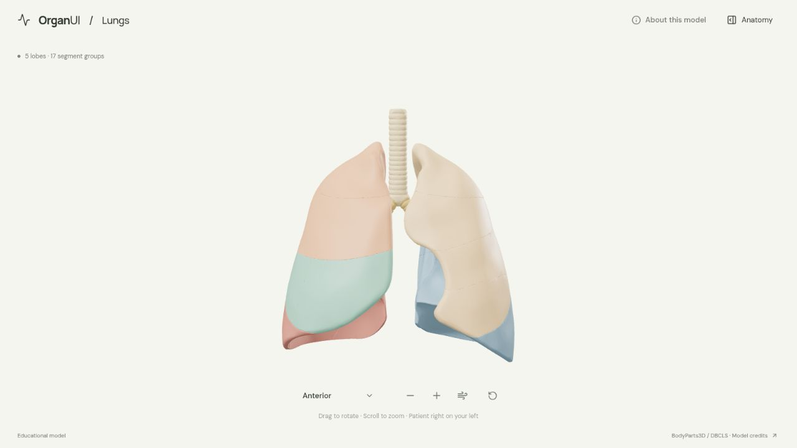
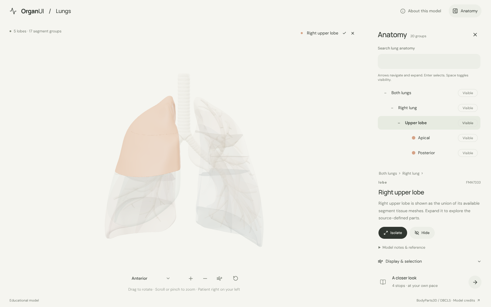

# OrganUI Lungs

A standalone, interactive lung anatomy explorer built with React, TypeScript, Three.js, React Three Fiber, Vite, and Bun.

The first working version is implemented and locally verified. Its full-height canvas, warm neutral colors, minimal camera toolbar, and collapsible anatomy panel follow the updated [OrganUI Heart](https://github.com/organui/heart-3d) design.



## Run locally

Use **Bun 1.4.2** and a browser with WebGL 2. From this repository:

```sh
bun install --frozen-lockfile
bun run dev --port 5182 --strictPort
```

Open [the local explorer](http://127.0.0.1:5182/). If that port is occupied, choose another; `--strictPort` prevents accidentally using a sibling app's port. The selected model and fonts are included locally. No API keys, sibling checkout, or model download is needed to run the app.

For a production build:

```sh
bun run build
bun run preview --port 5183 --strictPort
```

The static output is in `dist/`. Public deployment has not been performed.

## Explore

- Open **Anatomy** to search or expand the anatomy tree: both lungs → lung → lobe → segment group, and the airway tree (trachea, right and left bronchial trees). Selecting any row, including a lung or lobe, updates its description, breadcrumbs, and scene highlight. Each row's **Visible / Hidden / Mixed** button hides or shows that structure's scene parts.
- Drag to rotate, scroll or pinch to zoom, or use the toolbar. The view menu offers anterior, posterior, left lateral, and right lateral views.
- Use **Isolate**, **Hide**, and **Restore all** in the panel. Selecting a hidden structure makes it visible again. Reset restores the initial scene, camera, visibility, and opacity.
- The wind icon reveals the airway tree. **Display & selection** provides a surface-opacity slider and explicit lobe, segment, or airway picking. In airway mode, scene clicks pass through faded tissue.
- **A closer look** starts a four-stop tour through both lungs, a lobe, an isolated segment, and the airways.
- On mobile, the anatomy panel opens below the scene. **View in 3D** returns to the selected model.

Keyboard: focus the model and use arrow keys to rotate, `+`/`−` to zoom, and `Home` to reset. In the anatomy tree, arrows move and expand, Enter selects, and Space toggles visibility. All anatomy is also reachable through ordinary buttons and search. The view menu supports arrow keys, Home/End, letter navigation, and Escape. The model information dialog restores focus when closed. There is no automatic camera animation; interface transitions respect reduced-motion preferences.



### Anatomy tree

The panel's tree is the OrganUI registry component `anatomy-tree`, installed with the shadcn CLI into `src/components/ui/anatomy-tree.tsx` and kept unmodified. Each leaf row shows a swatch in its 3D color, and a selection made in the scene or the tour opens its branch and scrolls its row into view. Lung-specific mapping lives in `src/anatomy-adapter.ts`. See [registry integration](docs/REGISTRY_INTEGRATION.md) for the install command, checksums, and decisions.

## Model scope

The bundled **BodyParts3D / Anatomography 4.3** model contains five lobes assembled from **17 tissue segment groups**, plus the trachea and the right and left bronchial trees. Its 20 selectable leaf groups combine 119 original source elements. Parent structures are unions of these elements; they do not add overlapping shells.

This is the anatomy represented by this particular source model. No distinct medial-basal tissue surface is supplied. Left apicoposterior tissue combines two source pieces under one concept. Interior seams, simplified branches, cut ends, and imperfect local airway/tissue fit remain visible, especially with transparency. Colors are illustrative.

Labels, source relationships, coordinates, and interface behavior have been inspected during development. Independent anatomical review is pending. This educational demonstration does not simulate breathing, airflow, disease, or surgical planning.

See [model provenance and review notes](docs/MODEL_PROVENANCE.md), the [runtime manifest](public/models/manifest.json), and the in-app **About this model** dialog for sources, exact mappings, checksums, modifications, and limitations.

## Verification and asset recovery

```sh
bun test
bun run typecheck
bun run format:check
bun run verify:model
bun run build
```

The state tests cover hierarchy partitioning, visibility recovery, reset, and picking policy. The adapter tests cover the tree-to-scene mapping, its validation, and visibility conversion. Model verification independently checks the GLB checksum, anatomy IDs, unique source-element ownership, finite coordinates, topology, and patient laterality. [Verification notes](docs/VERIFICATION.md) record browser interaction checks and remaining limitations.

The app shows loading progress and retry controls for unavailable models, unavailable WebGL, and interrupted graphics contexts. Anatomy text remains accessible when rendering fails. If the bundled GLB is missing or altered, restore it from the repository or rebuild it:

```sh
bun run prepare:model
bun run verify:model
```

Preparation downloads checksum-pinned source OBJ files into ignored `.asset-cache/objs/`; this optional step needs network access. It validates original file headers and official anatomy mappings before applying a shared coordinate transform and conservative simplification. A complete fresh source download is approximately 14.7 MB.

## License and credits

Application code: [MIT](LICENSE).

Model and rendered model images: **BodyParts3D / Anatomography, © The Database Center for Life Science (DBCLS)**, adapted by OrganUI, under [CC BY-SA 2.1 Japan](https://creativecommons.org/licenses/by-sa/2.1/jp/deed.en). This follows the original 4.3 download service's license notice. The separate archive's CC BY 4.0 notice is not applied to these assets. See [model attribution](public/models/LICENSE.txt).

Manrope and DM Sans are self-hosted under SIL OFL 1.1; Lucide icons use ISC. The anatomy tree is from the OrganUI registry; it uses Base UI and Tailwind CSS (both MIT). Notices are in [public/licenses](public/licenses/).

Part of [OrganUI](https://github.com/organui), alongside [Heart](https://github.com/organui/heart-3d) and [Liver](https://github.com/organui/liver-3d).
